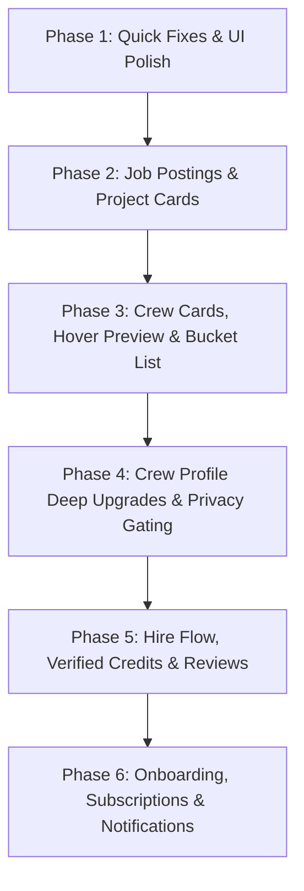

# 🎬 MissingCrew: 25-Task Client Requirements Audit & Implementation Roadmap

> **Audit Date:** October 2026  
> **Status:** Analyzed & Sequenced  
> **Guiding Principle:** Zero regressions on existing features, backward-compatible migrations, and clean modern UI aligned with MissingCrew design tokens.

---

## 📊 Executive Audit Summary

We analyzed the current Next.js 16 + React 19 + Supabase codebase across all 25 client items:
- **Already partially supported / ready for enhancement**: 8 items (Wishlists/Bucket list, Application statuses, Notifications system, Subscription model, Project screening questions).
- **Frontend / UI Enhancements**: 10 items (Job card layout, YouTube hover video preview, Pro badge, Footer links, Mobile gating, Portfolio tabs, Budget negotiable toggle).
- **New Features & Backend Models**: 7 items (Reviews table, 2-month trial auto-grant, Hire request workflow, Verified production credit badge, First project month/year, 1-click apply with portfolio links, AI project description assistant).

---

## 🗺️ Master Execution Roadmap (Phase-by-Phase)

---

### 🔹 Phase 1: Immediate UI Polish & Quick Wins
*Zero risk, no database schema changes, immediate visual improvement.*

| # | Task | Scope & Existing Code Analysis | Action |
|---|---|---|---|
| **9** | **Footer Cleanup** | `src/components/Footer.tsx` has dummy contact numbers and placeholder `#` social links. | Remove contact phone number. Add real links for Instagram, Facebook, LinkedIn, and YouTube. |
| **8** | **Preserve Crew Profile on Sign-in** | In `src/app/accounts/page.tsx` & `src/app/auth/callback/route.ts`, users are redirected to `/crew-home` or `/employer-home` on login, losing their place. | Preserve `redirectUrl` / `callbackUrl` query parameter so clicking "Sign In" from `/crew/[id]` returns the user back to that exact profile. |
| **24** | **Application Ordering** | Currently applications in `projectRepo` or dashboard use default or newest order. | Set `ORDER BY applied_at ASC` so the first person who applies appears at the top of the job submissions. |

---

### 🔹 Phase 2: Job Postings & Project Feed Display
*Focuses on Employers posting projects and Crew finding work.*

| # | Task | Scope & Existing Code Analysis | Action |
|---|---|---|---|
| **1** | **Job Card Layout & Hashtags** | In `ProjectCard.tsx` & `ProjectCardWrapper.tsx`, titles can truncate and metadata is distributed. | Ensure full title display, display category hashtags (e.g. `#FeatureFilm`, `#AdFilm`, `#WebSeries`), and align Location, Deadline, Posted Date, Roles Needed, and "Apply Now" cleanly on one side. |
| **25** | **Post a Project Refinements & AI Assistant** | In `src/app/post-a-job/page.tsx` and `employer/post-requirement/page.tsx`. | Add: standard Project Type selector, Crew Profession, optional shoot dates, Budget Range + FIXED toggle, city matching keyword support, screening questions, and integrated AI basic title/description generator. |

---

### 🔹 Phase 3: Crew Cards, Video Preview & Producer Bucket List
*Enhances discovery on Browse Crew and Homepage.*

| # | Task | Scope & Existing Code Analysis | Action |
|---|---|---|---|
| **2** | **Crew Card Overhaul & Hover Video** | `CrewCard.tsx` currently shows budget, project types, and languages. | Top YouTube video play-on-hover. Display: Name, Profession/Role, Photo, Location, Experience, Available dates. Remove budget, project types, and languages from card preview. Add "View Full Profile" button. "Mail" opens browser webmail on desktop or native mail app on mobile. |
| **17** | **Bucket List & "HIRE ALL"** | `wishlists` table already exists (`user_id`, `crew_id`) in Supabase. | Add "Add to Bucket / Cart" icon on crew cards. Create a slide-over / page Bucket List for producers with a "HIRE ALL" button that triggers batch booking requests. |
| **18** | **Advanced Crew Filtering** | `src/components/crew/CrewFilters.tsx`. | Add filters for: Profession, City, Map Radius (distance calculation), Available Dates, and Gender (Male / Female). |

---

### 🔹 Phase 4: Crew Profile Upgrades & Identity Gating
*Deeper profile customization, privacy controls, and portfolio organization.*

| # | Task | Scope & Existing Code Analysis | Action |
|---|---|---|---|
| **3** | **PRO Badge & Career Start Date** | `crew_profiles` table in Supabase. | Show prominent **PRO BADGE** for new profiles. Replace generic "years of experience" with "First Project Month/Year" (e.g., *Working since Oct 2018*). Add pre-made social/WhatsApp share message. |
| **4** | **Mobile Friendly & Identity Gating** | `src/app/crew/[id]/page.tsx`. | Ensure 100% mobile responsiveness. **Hide identity and direct contact details** (phone, WhatsApp, email) if visitor is NOT a signed-in Producer. |
| **5** | **Portfolio Tab Project Type Links** | Portfolio section in Crew Profile. | Under project categories (Ads, Web Series, Feature Films, etc.), clicking a category reveals direct clickable work/video links. Move this under the dedicated **PORTFOLIO** tab. |
| **6** | **Budget Range per Day & Negotiable** | `crew_profiles.daily_budget_min / max`. | Display as "Per Day". Add a "Negotiable" badge/pill if the crew member selected budget flexibility. |
| **19** | **Direct Producer Contacts** | For signed-in producers on Crew Profile. | Show IMDb link, Email, Phone/WhatsApp, and a 1-click message trigger button. |

---

### 🔹 Phase 5: Hire Flow, Verified Credits & Reviews System
*The core transaction and social proof engine.*

| # | Task | Scope & Existing Code Analysis | Action |
|---|---|---|---|
| **10** | **HIRE NOW Popup & Approval Request** | Currently connects via application status or basic request. | Clicking "HIRE NOW" opens a customizable pre-made booking message modal. Sends hire request to Crew with Accept/Decline action. |
| **11** | **🟢 Verified Production Credits** | When an application is hired and confirmed. | Add verified credit badge on crew profile: `🟢 Verified Production Credit; Project: XYZ; Role: Cinematographer; Production: ABC Studios; Dates: 12–25 Nov 2026, Confirmed by Producer`. Auto-populate from project details. |
| **12** | **Current Engagement Widget** | On Crew Profile sidebar. | Show `CURRENT ENGAGEMENT: Production: XYZ; Production House: ABC; Role: 1st AD; Engagement: 15 Nov – 4 Dec; Status: Confirmed` when currently booked. |
| **13** | **Reviews & Ratings System** | Need a new `reviews` table in Supabase. | Create `reviews` table (`id`, `crew_id`, `employer_id`, `project_id`, `rating`, `comment`, `created_at`). Gated strictly so ONLY employers who hired that crew member on platform can leave a review. |
| **7** | **Platform Experience Counter** | Profile stats counter. | Count and display the number of verified hired projects completed on MissingCrew. |

---

### 🔹 Phase 6: Onboarding, Subscriptions & Notifications
*Streamlining signup funnels and automated communication.*

| # | Task | Scope & Existing Code Analysis | Action |
|---|---|---|---|
| **14** | **Post-Signup Role Routing** | `src/app/accounts/page.tsx` & `/auth/complete-profile`. | New Crew users get routed directly to active projects (`/find-work`). New Producers get routed to `/browse-crew` with a prompt to post their first project. |
| **15** | **Progressive Crew Profile & 1-Click Apply** | Signup form + Apply modal. | Crew signup asks for minimum essential info; asks for additional details after first hire. 1-click apply automatically attaches matching relevant work links. |
| **16** | **Streamlined Producer Onboarding** | Producer signup form. | Minimum initial fields: Full Name, Production Company, Mobile Number. Prompt for remaining billing/company profile info upon first hire. |
| **20** | **2-Month Free Plan Auto-Grant** | `0001_auth_identity.sql` / registration route. | Auto-provision 60-day `FREE_TRIAL` with unlimited job applications on new Crew signup instead of the default 199 INR paywall. |
| **21** | **Referral Link Generator** | In user dashboard settings. | Generate unique referral share link (`missingcrew.com/?ref=USER_ID`) with 1-click copy and WhatsApp share button. |
| **22** | **Shortlist In-App & Email Notifications** | When employer updates status to `SHORTLISTED`. | Trigger in-app notification bell entry + automated email: *"Great news! You have been shortlisted by [Employer Name] for [Project Name]"*. |
| **23** | **Producer Job Milestone Emails** | Job post life cycle. | Email #1: Sent on job creation to review incoming candidates. Email #2: Sent automatically after 5 applications are received to encourage hiring. |

---

## 🔒 Safety & Non-Breaking Protocol
For every task in the roadmap:
1. **Database migrations are strictly additive** (adding optional columns / new tables, never dropping or altering existing columns destructively).
2. **Existing routes & APIs remain backward-compatible**.
3. **Automated test suite (`npm run test`) and TypeScript check (`tsc --noEmit`) run before any commit**.
4. **Code is committed and deployed only with user approval**.
